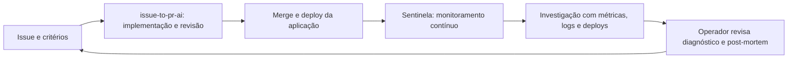

# Sentinela: monitoramento e ajustes de operação

Aplicação de referência com Next.js, TypeScript, LangGraph, MCP TypeScript v2, PostgreSQL/pgvector e provedores de IA intercambiáveis. Um worker acompanha a operação independentemente do navegador, detecta degradações e investiga a causa provável com evidências rastreáveis.

Além dos sinais da aplicação, conectores observam Deployments no Kubernetes e Function Apps no Azure. A área **Operação** permite propor reinício, ajuste de réplicas ou início de uma Function App, com políticas por alvo, revisão, auditoria e verificação do resultado. Consulte o [guia de monitoramento e ajustes](docs/operations.md). Nenhum acesso externo é habilitado por padrão.

O Sentinela complementa o [issue-to-pr-ai](https://github.com/lucasnscr/issue-to-pr-ai): o projeto de entrega organiza a issue, a implementação, os testes e a revisão; o Sentinela acompanha a aplicação depois do deploy. Incidentes e post-mortems fornecem evidências para a próxima issue, mantendo a decisão de mudança com o mantenedor.

Consulte o [guia de integração com o catálogo Java/Spring](docs/issue-to-pr-ai.md), com patch de instrumentação, recording rules do Prometheus e registro autenticado de deploys. A integração externa exige configuração; o laboratório local já funciona sem outro projeto.

## Executar localmente

Requisitos: Node.js 24+, npm e Docker com Compose.

    git clone https://github.com/lucasnscr/sentinela.git
    cd sentinela
    npm ci
    npm run db:up
    npm run db:migrate
    npm run dev

Interface: http://127.0.0.1:4320

O comando dev inicia a interface e o worker. Use .env.example como referência e salve suas configurações em .env.local, ignorado pelo Git. A configuração inicial usa análise por regras e busca lexical, sem exigir chave de IA. Diagnóstico e embeddings podem usar provedores diferentes.

PostgreSQL usa a porta 56471 no host e um volume Docker persistente. Se essa porta estiver ocupada, ajuste compose.yaml e DATABASE_URL juntos. Encerrar o Compose sem a opção -v preserva os dados.

Para executar o laboratório e os testes sem inferência:

    npm run dev -- --rules

Para executar o build de produção, mantenha web e worker em processos separados:

    npm run build
    npm start

Em outro terminal:

    npm run worker

A interface e os serviços de demonstração usam loopback. Esta versão é uma referência local de operador único. Autenticação de usuários, isolamento entre organizações e implantação com múltiplos workers não estão implementados.

## Experimentar o fluxo completo

1. Abra Laboratório e ative um cenário.
2. Após duas amostras consecutivas de degradação, o monitor abre uma investigação automaticamente.
3. Abra o incidente e consulte Diagnóstico, Evidências e Linha do tempo.
4. Revise a mitigação. A execução altera apenas o laboratório local.
5. O incidente só é resolvido após três amostras consecutivas saudáveis e com tráfego.
6. Exporte o rascunho de post-mortem.

Amostras são obtidas a cada quatro segundos por padrão, em uma janela móvel de 12 segundos. Como as janelas se sobrepõem, as três confirmações não devem ser interpretadas como observações estatisticamente independentes.

| Cenário | Mecanismo produzido | Mitigação permitida |
| --- | --- | --- |
| Saturação do pool | Pool de payments reduzido e conexões retidas; requisições HTTP reais falham | Restaurar configuração do pool |
| Latência na dependência | Inventory excede o deadline real usado pelo checkout | Remover atraso adicional |
| Regressão de deploy | Payments rejeita a assinatura na versão nova | Reverter versão de pagamentos |

Os serviços recebem tráfego HTTP contínuo. Métricas, logs, spans de requisições e alterações são registrados pelo laboratório. O investigador não recebe o identificador do cenário de falha; consulta apenas as evidências operacionais pelas ferramentas MCP. A topologia conhecida é checkout → payments e inventory.

A instrumentação de spans HTTP do laboratório é armazenada no PostgreSQL. A exportação OpenTelemetry opcional instrumenta as etapas do worker; não representa instrumentação automática completa dos serviços externos.

## Arquitetura

    Serviços HTTP / Prometheus / webhook
                     |
               worker contínuo
                     |
             detecção e correlação
                     |
             grafo de investigação
        coleta → análise → verificação
                     |
              revisão persistida
                     |
              ação no laboratório
                     |
              verificação contínua
                     |
              incidente resolvido

A interface Next.js lê o estado pelo PostgreSQL e recebe atualizações por SSE. Ela não executa o laço de monitoramento.

- lib/db.ts: schema, incidentes, fila de comandos, telemetria e eventos.
- worker/index.ts: monitoramento, recuperação de trabalhos e coordenação.
- worker/investigation.ts: grafo LangGraph, checkpoints e interrupt de revisão.
- worker/mcp.ts: servidor MCP v2, com transporte stdio.
- worker/mcp-client.ts: cliente do servidor MCP usado pelo investigador.
- lib/knowledge.ts: embeddings e recuperação por busca textual e vetorial com fusão de rankings.
- lib/diagnosis.ts: diagnóstico por evidências e validação das ações.
- lib/ai.ts: indisponibilidade do provedor e bloqueio de tentativas repetidas.
- app/page.tsx: cockpit responsivo, laboratório, runbooks e revisão.

Uma trava advisory do PostgreSQL permite um worker por banco. No máximo duas investigações são iniciadas simultaneamente. Checkpoints preservam o estado e as revisões pendentes após reiniciar o worker. Comandos de revisão usam chave de idempotência, e ações têm unicidade por incidente e tipo. As mitigações disponíveis restauram estado conhecido e toleram reexecução.

O diagnóstico é classificado como provável ou inconclusivo. Referências a evidências inexistentes invalidam a ação. Uma alteração próxima no tempo, sozinha, não basta para o diagnóstico por regras.

## Provedores de IA e análise por regras

Diagnóstico e embeddings possuem configurações independentes. Os adaptadores incluem OpenAI, APIs compatíveis, Anthropic, Google Gemini e Ollama local. Nenhum provedor comercial é obrigatório em uma instalação nova.

Configure AI_PROVIDER e AI_MODEL para o diagnóstico; EMBEDDING_PROVIDER e EMBEDDING_MODEL controlam a busca semântica. Endpoints, credenciais e dimensões também são configuráveis. Reinicie a interface e o worker depois de alterar o ambiente.

O banco aceita diferentes dimensões de embeddings e compara apenas vetores do mesmo espaço/modelo. Ao trocar o modelo de embeddings, os runbooks são reindexados; a busca lexical continua disponível. Falhas de provedores e funções diferentes têm circuitos independentes.

Cada diagnóstico registra o modo usado e, quando há inferência, o provedor e o modelo. A configuração OPENAI_* da versão anterior é preservada como compatibilidade, sem impedir a seleção de outro adaptador.

Consulte [configuração de provedores, exemplos e extensão](docs/ai-providers.md). A tela Conexões apresenta e testa diagnóstico e embeddings separadamente.

## Conectar telemetria externa

Defina LAB_ENABLED=false, PROMETHEUS_URL e MONITORED_SERVICES no ambiente do worker e da interface. As consultas atuais esperam séries normalizadas com label service:

- sentinela_service_error_ratio: fração de erros entre 0 e 1.
- sentinela_service_latency_p95_ms: latência p95 em milissegundos.
- sentinela_service_requests_per_minute: volume por minuto.
- sentinela_service_saturation_ratio: saturação entre 0 e 1, opcional.

Crie recording rules para mapear as métricas dos seus serviços a esse contrato. Ausência de uma série não é interpretada como saúde. O detector desta versão não abre um incidente específico para perda de telemetria.

Para investigar além das métricas, envie logs, traces e alterações normalizados para POST /api/telemetry, autenticado com Bearer TELEMETRY_INGEST_TOKEN:

    {
      "events": [{
        "id": "deploy-payments-241",
        "kind": "change",
        "service": "payments",
        "at": "2026-10-26T12:00:00.000Z",
        "title": "Deploy payments-2.4.1",
        "detail": "Alteração no validador de assinaturas",
        "data": {"version": "payments-2.4.1"}
      }]
    }

O endpoint aceita log, trace e change, limita lote e tamanho e verifica os serviços configurados. IDs iguais são idempotentes. Proteja e normalize os dados na origem; esta versão não inclui conectores nativos para Loki, Tempo ou plataformas de deploy.

O comando `npm run report:deployment` envia um evento de alteração com repositório, commit, ambiente e referências opcionais à issue e à PR. `-- --dry-run` permite revisar o evento sem enviá-lo. Consulte as [variáveis e o exemplo de uso](docs/issue-to-pr-ai.md#registrar-o-deploy).

POST /api/alerts recebe payloads Alertmanager com alerts[].labels.service e status=firing. Configure ALERT_WEBHOOK_TOKEN e um proxy que envie o Bearer correspondente. Alertas resolved recebidos não encerram incidentes sem confirmação nas métricas. Webhook sem token configurado fica desabilitado.

Telemetria externa, por si só, gera recomendações consultivas. Para executar ajustes em Kubernetes ou Azure Functions, configure um [conector operacional](docs/operations.md), seus alvos e permissões. Os planos externos têm revisão e autorização próprias; os três procedimentos do laboratório continuam isolados.

Para observar as métricas do laboratório no Prometheus:

    docker compose --profile observability up -d

O Prometheus fica em http://127.0.0.1:9090 e coleta o endpoint do worker na porta 4424. O arquivo infra/alerts.yml contém um exemplo de regra. Alertmanager não faz parte do Compose; o monitor do copiloto funciona sem ele.

OTEL_EXPORTER_OTLP_ENDPOINT habilita a exportação dos spans das chamadas do investigador para um collector externo.

## Testes

    npm run check
    npm test
    npm run test:integration
    npm run build

Com a aplicação em execução e sem incidente ativo:

    npm run test:e2e

O E2E ativa e resolve os três cenários, confere referências, repete a revisão para validar idempotência e verifica exportação e origem recusada. Use npm run dev -- --rules durante essa verificação para não consumir inferências.

    npm run test:e2e:provider

Executa os três cenários com um servidor HTTP que simula o protocolo Ollama e embeddings de três dimensões. O teste inicia seus próprios processos e usa um banco temporário, sem credenciais externas e sem modificar o histórico local. Requer permissão para criar um banco no PostgreSQL de desenvolvimento e uma instância de next dev livre neste checkout. Não utiliza um modelo real.

    npm run test:e2e:operations

Inicia web e worker em banco temporário, com CLIs controladas de Kubernetes e Azure Functions. Verifica incidentes, proposta, token, aprovação idempotente, ajuste e recuperação sem acessar contas ou clusters reais. Use `-- --preview` para inspecionar a interface de teste; encerre o processo para remover a prévia e o banco temporário.

    npm run test:e2e -- --one

Testa apenas saturação do pool.

    npm run test:ai

Faz uma chamada real curta ao provedor de diagnóstico configurado. Use npm run test:ai -- --embedding para testar somente o provedor de embeddings. Nenhuma credencial é impressa.

Os testes de integração usam registros isolados com identificadores aleatórios e removem apenas seus próprios dados. Não limpe o volume Docker para executar testes.

A CI executa tipagem, testes unitários e de integração, build e os três cenários completos com um provedor controlado. Nenhuma credencial de IA é necessária.

## Operação

- GET /api/health: disponibilidade do banco e heartbeat do worker.
- GET /api/snapshot: estado atual do cockpit.
- GET /api/events: streaming SSE de snapshots.
- POST /api/commands: fila de comandos da interface.
- GET /api/commands/:id: resultado do comando.
- GET/POST /api/knowledge: consulta e inclusão de runbooks.
- GET /api/incidents/:id/postmortem: exportação Markdown.
- POST /api/ai/check: teste manual do provedor.
- POST /api/alerts e POST /api/telemetry: ingestão externa autenticada.

Métricas são retidas por um dia, evidências brutas por dois dias e eventos por 30 dias. As evidências anexadas a incidentes continuam no registro do incidente. Não há exclusão automática dos checkpoints ou incidentes nesta versão.

Para disponibilizar fora do computador, implemente autenticação, autorização e políticas de retenção adequadas ao ambiente. Configure proxy com streaming sem buffering e APP_ORIGINS com as origens autorizadas. O Dockerfile gera a aplicação; o worker precisa de um processo separado, do mesmo banco e das variáveis correspondentes.

## Fontes técnicas

- Next.js: https://nextjs.org/docs/app/getting-started/route-handlers
- LangGraph: https://docs.langchain.com/oss/javascript/langgraph/persistence
- MCP TypeScript v2: https://ts.sdk.modelcontextprotocol.io/v2/
- pgvector: https://github.com/pgvector/pgvector#hybrid-search
- OpenAI Structured Outputs: https://developers.openai.com/api/docs/guides/structured-outputs
- Prometheus: https://prometheus.io/docs/alerting/latest/overview/
