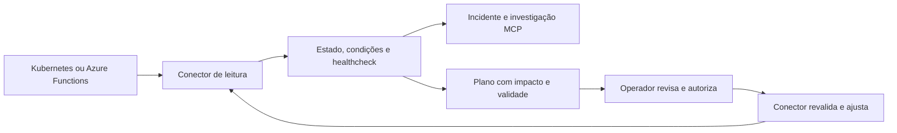

# Monitoramento e ajustes de operação

O Sentinela observa a aplicação e seu ambiente de execução. Os conectores atuais incluem Kubernetes (Deployments) e Azure Functions (Function Apps). As observações entram no histórico de evidências, geram incidentes e permitem propor ajustes operacionais sem depender de um modelo de IA.



## Capacidades implementadas

| Ambiente | O que observa | Ajustes permitidos |
| --- | --- | --- |
| Kubernetes | Réplicas desejadas, prontas e disponíveis; geração e rollout; pods pertencentes ao Deployment; condições de containers; HPA e motivos de eventos Warning | Reiniciar por alteração da anotação do pod template; ajustar réplicas dentro dos limites |
| Azure Functions | Identidade, estado e habilitação da Function App; healthcheck HTTP configurado | Iniciar uma Function App parada; reiniciar uma Function App em execução |

O conector Kubernetes reconhece `CrashLoopBackOff`, `OOMKilled`, erros de imagem, containers mal configurados, falhas de agendamento e rollout. Eventos históricos são contexto; um `OOMKilled` antigo em container atualmente pronto não degrada sozinho o alvo. Deployment com zero réplicas é inativo, sem incidente de disponibilidade. Deployment pausado tem saúde não confirmada.

Azure `Running` confirma o plano de controle, mas não prova execução saudável. Sem `healthUrl`, o painel mostra saúde não confirmada e não permite ajustes. Uma Function App parada gera degradação quando `expectedRunning=true`; use `false` se a parada for intencional. O healthcheck deve responder HTTP 200 e, se necessário, aceitar a chave de função pelo header `x-functions-key`. O Sentinela não consulta host keys, app settings nem connection strings.

As regras HTTP do Prometheus continuam independentes. Conecte métricas e envie logs/traces para investigar erros, latência, triggers e dependências além do estado do runtime. Ainda não há consulta nativa a Application Insights, Azure Monitor, filas, nodes ou métricas de CPU/memória do cluster. Escala e configuração de planos serverless não fazem parte deste conector.

## Configurar alvos explícitos

No worker, instale `kubectl` para Kubernetes e Azure CLI (`az`) para Functions. Configure acesso de leitura às identidades e recursos desejados. O Sentinela não executa login, não troca o contexto atual e não instala extensões do Azure CLI.

```sh
cp examples/operations/targets.json operations.local.json
```

Edite `operations.local.json`, removendo o ambiente que não utilizar e substituindo os identificadores de exemplo. Kubernetes exige `context`, `namespace` e `deployment`; Azure exige o resource ID completo da Function App. Não há descoberta de clusters, subscriptions ou aplicações fora dessa lista. Cada alvo deve ter `id` e `service` únicos nesta instalação.

Configure `.env.local` para observação e planejamento:

```dotenv
LAB_ENABLED=false
OPERATIONS_ENABLED=true
OPERATIONS_CONFIG_FILE=./operations.local.json
OPERATIONS_EXECUTION_ENABLED=false
OPERATIONS_INTERVAL_MS=15000
OPERATIONS_COOLDOWN_MS=300000
```

Configure `OPERATIONS_API_TOKEN` com um segredo aleatório de pelo menos 24 caracteres para gerar planos e registrar revisões. API e worker devem usar o mesmo arquivo e variáveis. Esse segredo é separado das credenciais Kubernetes/Azure e das chaves do healthcheck. Se o healthcheck exigir uma function key, configure a variável nomeada por `healthKeyEnv` somente no servidor; não coloque o valor no JSON, na URL ou no Git. Healthcheck remoto autenticado exige HTTPS.

```sh
npm run db:migrate
npm run dev
```

No painel, abra **Operação**. O token digitado fica apenas no estado da tela, sem armazenamento em localStorage. O estado dos alvos e os planos são atualizados por SSE.

O Dockerfile principal contém Node.js e a aplicação; não contém `kubectl` ou Azure CLI. Execute o worker em um ambiente com essas ferramentas e identidades configuradas, ou prepare uma imagem própria. Nenhuma implantação em um cluster ou conta Azure é feita pela ativação do painel.

## Permitir ajustes

Cada alvo define `actions`. Lista vazia significa apenas observação. `minReplicas` e `maxReplicas` limitam escala Kubernetes; HPA bloqueia a escala manual. O exemplo de [RBAC Kubernetes](../examples/operations/kubernetes-rbac.yaml) separa observação e ajuste. Para usar somente leitura, aplique apenas os objetos de observação; a Role de ajuste e sua RoleBinding são opcionais. Use uma identidade/contexto dedicado e restrito ao namespace.

No Azure, uma identidade de leitura é suficiente para observar. O [exemplo de role](../examples/operations/azure-role.json) acrescenta start/restart; atribua-a somente ao resource ID da Function App autorizada. Adapte o scope antes de criar a role. Não é necessário conceder leitura de segredos, acesso a código ou permissão de atualização geral da aplicação.

Depois de configurar permissões e revisar os alvos, habilite a execução no ambiente do worker e reinicie-o:

```dotenv
OPERATIONS_EXECUTION_ENABLED=true
```

1. Gere um plano para o alvo, ação e quantidade de réplicas desejados.
2. Revise o estado anterior, o impacto e o resultado esperado. O plano vale por cinco minutos.
3. Marque a revisão e selecione **Aprovar e executar**. Recusar apenas encerra a proposta.
4. O worker reserva o plano, observa novamente o provedor e compara alvo, versão e política. Mudanças exigem outro plano.
5. O comando fica em verificação. Três novas coletas saudáveis confirmam o resultado; métricas recentes da aplicação, quando presentes, também devem estar saudáveis.

No Kubernetes, JSON Patch testa UID e resourceVersion antes da alteração. Reinícios usam o ID do plano em uma anotação determinística e preservam as demais anotações. Escala manual não é permitida com HPA observado. Ainda existe uma janela entre observar um HPA e aplicar a alteração em outro objeto; mantenha a política de escala coordenada com seus controladores e GitOps.

No Azure, o conector verifica identidade e estado antes da chamada CLI, mas start/restart não possuem nesta integração uma precondição atômica equivalente ao resourceVersion. Coordene mudanças concorrentes com o pipeline. Reiniciar pode interromper execuções e não desfaz efeitos de triggers.

O reinício não corrige automaticamente uma imagem inválida, limite de memória incorreto ou defeito de código. Nesses casos, a investigação orienta uma mudança pelo `issue-to-pr-ai`. Propostas automáticas são limitadas a Function App inesperadamente parada (iniciar) e healthcheck com falha em workload aplicável (reiniciar); continuam exigindo aprovação. Outras ações são solicitadas pelo operador.

## Falhas, auditoria e recuperação

Somente um plano pode estar ativo por alvo. A aprovação é reservada atomicamente no PostgreSQL, e novas execuções respeitam o cooldown. O fluxo registra proposta, revisão, envio e resultado, com referência ao incidente quando houver.

Se a chamada falhar ou o worker reiniciar durante a execução, o resultado pode ser incerto. O Sentinela não repete a chamada automaticamente e bloqueia outro plano para o alvo. Confira o estado no provedor e use **Registrar conferência** para documentar a conclusão. Essa ação não repete o ajuste nem afirma que houve recuperação.

Se o provedor aceitar o comando, mas o estado esperado não aparecer em cinco minutos, o plano termina sem recuperação confirmada. Ausência de telemetria, erro de CLI e healthcheck indisponível não contam como amostras saudáveis. Desabilitar operações encerra novas coletas/ajustes; o histórico permanece no banco. Planos e observações operacionais não possuem retenção automática nesta versão.

O token compartilhado representa o operador desta referência local. Autenticação individual, RBAC de usuários e múltiplas organizações continuam fora do escopo da aplicação atual.

## Fontes e verificação

- [Condições e progresso de Deployments](https://kubernetes.io/docs/concepts/workloads/controllers/deployment/).
- [JSON Patch com kubectl](https://kubernetes.io/docs/reference/kubectl/generated/kubectl_patch/).
- [Escala horizontal e HPA](https://kubernetes.io/docs/concepts/workloads/autoscaling/horizontal-pod-autoscale/).
- [Azure CLI: Function App show/start/restart](https://learn.microsoft.com/en-us/cli/azure/functionapp).
- [Métricas e limites por plano do Azure Functions](https://learn.microsoft.com/en-us/azure/azure-functions/monitor-functions-reference).

Os testes usam dados de Kubernetes e respostas Azure controlados, com PostgreSQL real e um healthcheck HTTP local. Nenhum cluster ou conta Azure real foi alterado. A validação em uma instalação real exige suas identidades e alvos configurados.
