# Ciclo integrado com issue-to-pr-ai

O ciclo liga um incidente ao trabalho corretivo e verifica a entrega resultante. Não concede autorização de implementação, aprovação ou merge a partir de logs ou de um diagnóstico.

```mermaid
flowchart LR
  A[Incidente observado] --> B[Proposta revisada no Sentinela]
  B --> C[Issue sem ai:ready]
  C --> D[Mantenedor autoriza o fluxo issue-to-pr-ai]
  D --> E[Implementação, testes, draft PR e CI]
  E --> F[Mantenedor decide merge e entrega]
  F --> G[Artefato por digest e deploy]
  G --> H[Sentinela verifica novas amostras]
  H --> I[Correção verificada ou rollback]
```



## Contrato e identidades

`contracts/sdlc-v1.mjs` é idêntico nos dois repositórios. O teste integrado compara os bytes antes de iniciar. Mudanças incompatíveis exigem outra versão do protocolo.

O caso conserva incidente, serviço, ambiente e repositório; a publicação acrescenta issue; a CI vincula PR e SHA; a entrega acrescenta commit implantado, digest imutável e identificador do deploy. Eventos não podem trocar essas identidades durante uma entrega. Reenvios do mesmo evento são idempotentes; reutilizar seu ID para outro conteúdo é recusado. O horário de recebimento no Sentinela define o início da verificação, sem confiar no relógio do emissor.

## Preparar o Sentinela

Configure no ambiente da interface e do worker:

```dotenv
SDLC_ENABLED=true
SDLC_REPOSITORY=lucasnscr/issue-to-pr-ai
SDLC_ENVIRONMENT=staging
SDLC_SERVICES=catalog-api
SDLC_GITHUB_TOKEN_ENV=SENTINELA_GITHUB_TOKEN
SDLC_VERIFY_TIMEOUT_MS=300000
LAB_ENABLED=false
MONITORED_SERVICES=catalog-api
PROMETHEUS_URL=http://127.0.0.1:9091
```

Provisione separadamente, fora do Git:

- `OPERATIONS_API_TOKEN`: segredo do operador para propostas e publicação de issues.
- `SENTINELA_GITHUB_TOKEN`: credencial do worker limitada a leitura/escrita de issues no repositório destino. Instale `gh` no worker; ele é usado com host explícito github.com e sem prompts.
- `SDLC_CALLBACK_TOKEN`: segredo de pelo menos 24 caracteres usado somente pelo pipeline confiável, diferente do token do operador.

Execute a migração e reinicie interface/worker. Abra `/sdlc`, também acessível pela área Operação. Selecione o incidente, escreva a descrição e os critérios e prepare a proposta. Revise o Markdown e autorize a publicação no repositório indicado. São exportados apenas IDs/tipos/títulos de evidências selecionadas e o resumo revisado; logs brutos e dados completos de traces não são incluídos.

Padrões conhecidos de credenciais e parâmetros de URLs são removidos, mas isso não substitui revisão de dados pessoais ou confidenciais. Nenhuma publicação deve acontecer sem conferir o conteúdo e o destino. Uma proposta ainda não publicada pode ser preparada novamente com o texto revisado; sua hash muda e invalida uma autorização anterior.

A publicação usa um marcador com case ID e hash da proposta. Repetir o comando retorna a mesma issue. Se GitHub não confirmar a resposta, o estado passa a `publish_uncertain`; **Conferir publicação** procura a issue sem criar outra. Ausência de confirmação exige investigar no GitHub, sem reenvio automático.

## Preparar o repositório de entrega

No issue-to-pr-ai, configure `SENTINELA_ENABLED=true`, `SENTINELA_URL`, `SENTINELA_SERVICE` e `SENTINELA_ENVIRONMENT` nas variáveis do repositório. Provisione `SENTINELA_CALLBACK_TOKEN` como secret com o mesmo valor de `SDLC_CALLBACK_TOKEN` no Sentinela. O endereço deve ser alcançável pelo runner: loopback do seu computador não é acessível por um runner hospedado.

`sentinela-sync.yml` responde à conclusão da CI. Executa somente código da branch padrão, sem checkout candidato ou download de artefatos. Confere repositório, SHA atual da PR e issue vinculada antes de enviar `implementation.published`. Issues sem marcador são ignoradas. O agente continua dependendo de colaborador autorizado, issue aberta e `ai:ready`; o Sentinela não adiciona a label nem comenta comandos para iniciar o agente.

Para o piloto de entrega Kubernetes, crie/proteja o environment GitHub **sentinela-delivery** com decisão do mantenedor. Configure nele as variáveis de alvo `SENTINELA_KUBE_CONTEXT`, `SENTINELA_KUBE_NAMESPACE`, `SENTINELA_KUBE_DEPLOYMENT`, `SENTINELA_KUBE_CONTAINER`, além das variáveis Sentinela acima. Provisione `SENTINELA_KUBE_CONFIG_B64` e o callback token nesse environment, com acesso restrito ao Deployment. A imagem anterior deve estar fixada por digest para permitir rollback reproduzível.

Habilite `SENTINELA_DELIVERY_ENABLED=true` no repositório somente após revisar ambiente, permissões e acesso ao registry. O workflow manual aceita a PR corretiva já integrada, roda Maven/PostgreSQL, publica a imagem no GHCR por digest e usa um job separado para implantação. Só executa na branch padrão. Configure previamente PostgreSQL, credenciais de pull e o Deployment; o workflow não cria infraestrutura nem altera permissões.

A entrega aplica a imagem com precondições de UID/resourceVersion, aguarda o rollout e envia `deployment.completed`. O Sentinela exige três amostras HTTP saudáveis, distintas e posteriores ao evento, com tráfego. Amostras antigas, repetidas ou ausentes não verificam a correção. Cada instalação monitora um ambiente explícito; o contrato de métricas atual identifica serviço, sem isolamento multitenant.

Se a recuperação não for confirmada no prazo, o pipeline tenta restaurar a imagem anterior e registra `deployment.rolled_back`. Se alvo/imagem tiverem mudado concorrentemente, o rollback não sobrescreve a mudança e exige conferência. Falha ou rollback nunca resultam em `verified`. O fechamento da issue pelo merge também não verifica o caso operacional.

## Ajustes permanentes

Use o tipo **Configuração permanente versionada** para transformar uma mitigação em trabalho de manutenção com critérios sobre o estado desejado no Git. Isso não altera o escopo do agente Java: infraestrutura, GitOps e políticas continuam sob o mantenedor. O ajuste temporário e sua correção permanente têm decisões próprias.

## Executar o teste integrado

Com os dois checkouts, Node.js 24, Java 21, Maven Wrapper, Docker e PostgreSQL/pgvector de desenvolvimento disponíveis:

```sh
ISSUE_TO_PR_AI_DIR=/caminho/issue-to-pr-ai npm run test:e2e:sdlc
```

O teste cria um banco Sentinela temporário, rede/containers PostgreSQL, catálogo Java e Prometheus isolados. Implanta uma regressão HTTP 503 no checkout temporário do catálogo, detecta o incidente, publica a issue em GitHub controlado, exercita os gates existentes e o wrapper governado do agente, verifica um teste de regressão vermelho, corrige e executa Maven/PostgreSQL completos. Em seguida vincula a PR, implanta o artefato corrigido e aguarda três novas amostras saudáveis. Uma segunda entrega intencionalmente defeituosa exercita a recusa e o rollback.

GitHub, resposta do agente e decisão de merge são controlados; aplicação, banco, HTTP, Prometheus, worker, MCP, validações e substituição dos containers são reais. Nenhum agente comercial, issue remota de teste, merge real ou ambiente de produção é acionado. O digest local é o ID imutável da imagem Docker; o workflow de entrega usa o digest de manifest publicado no registry. O teste usa janelas Prometheus de 10 segundos para reduzir a duração; o exemplo operacional usa um minuto.

Os recursos criados pelo teste são removidos ao terminar. O relatório fica em `test-results/sdlc-integration-report.json`, ignorado pelo Git. A CI integrada executa contra o commit do outro repositório fixado em `config/sdlc-peer.json`; atualize essa referência somente após conferir os dois contratos e repetir o teste.
